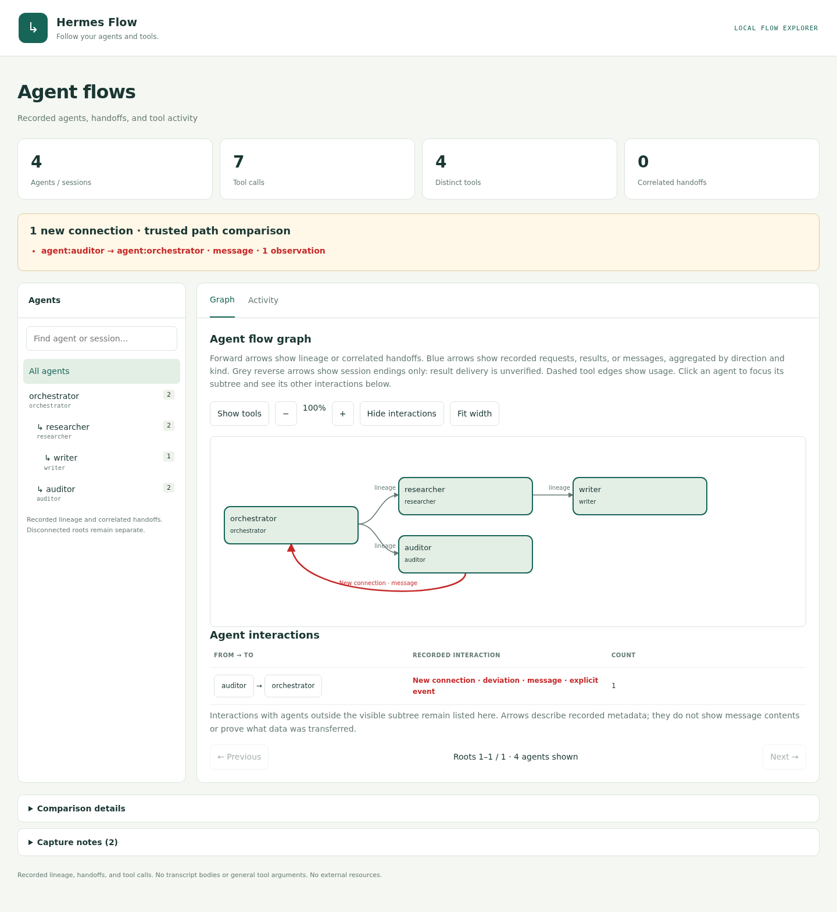
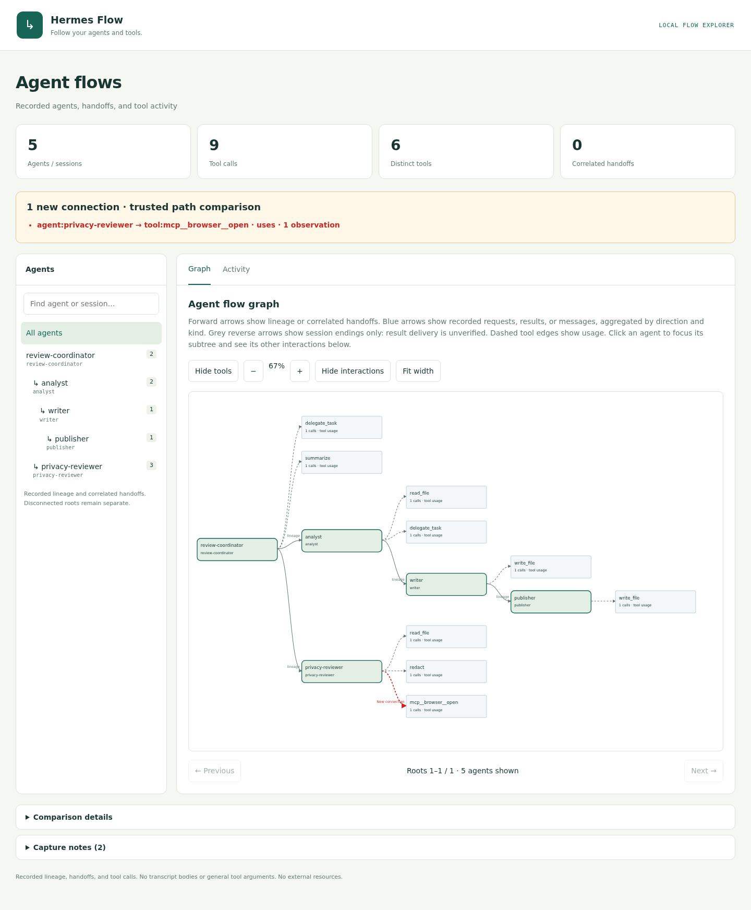

# Hermes Flow

Inspect and reconstruct Hermes agent sessions as a local HTML graph and
terminal tree.

Hermes Flow reads the existing Hermes session database and reconstructs the
recorded history: agent lineage, handoffs, tool calls, timing, outcomes, and
captured interaction evidence. It can inspect one session tree, all recorded
sessions, or exported JSON/JSONL. It also compares later runs with a reviewed
trusted-paths baseline. Reports are generated locally with no telemetry or
external services.

## See the signal first

The screenshots show two different workflows: the first demonstrates an
unexpected agent message in a four-agent flow; the second shows a separate
five-agent review flow with an unexpected browser-tool connection.

The primary view shows the flow and one reverse connection outside the trusted
path, highlighted in red:



The second view shows a different workflow and deviation: a privacy reviewer
using a new
`mcp__browser__open` tool. The summary names the connection:



Reports show new connections above the graph. Capture notes and baseline
details stay collapsed below it.

Both screenshots keep tool nodes visible. The first contains six ordinary
tool calls plus a separate red message edge; the second contains nine calls,
including the new browser connection.

## Reconstruct existing Hermes history

This is the core workflow: install the plugin, then inspect sessions that are
already recorded by Hermes. No new agents need to run and Hermes Flow does not
modify the database.

```bash
hermes flow sessions                 # list recorded sessions
hermes flow --session-id SESSION_ID --open  # session and descendants
hermes flow --all-sessions --open    # reconstruct all recorded sessions
```

The reconstruction is intentionally metadata-only. Reports include the
structure and activity needed to understand a run, but omit prompts, model
reasoning, result bodies, and general tool arguments.

## Connect to Hermes (optional)

To use this checkout as a Hermes plugin, run the local installer:

```bash
bash scripts/install-local.sh
```

The script validates and links this directory at
`~/.hermes/plugins/hermes-flow` (or under `$HERMES_HOME/plugins`), enables the
plugin, and opens a synthetic demo. It requires an installed Hermes CLI. To
remove the local link, disable the plugin and remove that symlink.

Once this repository is published and accessible to the installer, users can
install it directly from Git:

```bash
hermes plugins install rewanthtammana/hermes-flow --enable
```

The root `plugin.yaml` supports native Git installation. See the
[Hermes plugin guide](https://github.com/NousResearch/hermes-agent/blob/main/website/docs/user-guide/features/plugins.md)
for installation options and [publishing notes](docs/PUBLISHING.md) for catalog
submission.

## Quick start

Preview a synthetic flow from this checkout:

```bash
python3 -m hermes_flow demo --open
```

After installing the plugin, inspect recorded sessions (see the core history
workflow above):

```bash
hermes flow sessions
hermes flow --session-id SESSION_ID --open
```

Useful selectors and output options:

```bash
hermes flow                         # all recorded sessions
hermes flow --all-sessions --open
hermes flow --session-id ID1,ID2
hermes flow --out report.html
hermes flow show events.jsonl --graph mermaid --out flow.html
```

Each run prints a terminal tree and writes a self-contained HTML report. Use
`--open` to launch it, `--out PATH` to choose the output path, and `--force` to
replace an existing report.

## Trusted-path comparison

Create a baseline from known-good history, then compare later runs:

```bash
hermes flow baseline create --session-id SESSION_ID --out trusted-paths.json
hermes flow --session-id NEW_SESSION_ID \
  --compare-with-trusted-paths trusted-paths.json --open
```

New directed connections are highlighted in red. Baseline files are editable
JSON and are never changed by comparison. Matching uses agent labels (with
configured aliases), direction, tool names, and connection type. This is a
post-run check of individual connections; it does not prove execution order or
tool safety.

### Reproduce both one-deviation examples

The first adds an `auditor → orchestrator` message to a four-agent flow. The
second uses a separate five-agent review flow and adds a
`privacy-reviewer → mcp__browser__open` tool call. Each report has one new
connection.

```bash
python3 - <<'PY'
from pathlib import Path

from hermes_flow.baseline import compare, create, read, write
from hermes_flow.cli import observe, render

rows = []
for sid, parent, tools in (
    ("orchestrator", None, ["delegate_task", "summarize"]),
    ("researcher", "orchestrator", ["read_file", "delegate_task"]),
    ("writer", "researcher", ["write_file"]),
    ("auditor", "orchestrator", ["read_file"]),
):
    for i, tool in enumerate(tools):
        rows.append({
            "session_id": sid,
            "agent_role": sid,
            "parent_session_id": parent,
            "tool": tool,
            "call_id": f"{sid}-{i}",
            "timestamp": 1792843200 + len(rows),
            "status": "ok",
        })

trusted = create(observe(rows))
baseline_path = Path("example-trusted-paths.json")
write(baseline_path, trusted)
message_rows = rows + [{
    "session_id": "auditor",
    "agent_role": "auditor",
    "parent_session_id": "orchestrator",
    "tool": "read_file",
    "call_id": "auditor-back",
    "timestamp": 1792843210,
    "status": "ok",
    "interaction": {
        "target_session_id": "orchestrator",
        "kind": "message",
    },
}]
review_rows = []
for sid, parent, tools in (
    ("review-coordinator", None, ["delegate_task", "summarize"]),
    ("analyst", "review-coordinator", ["read_file", "delegate_task"]),
    ("privacy-reviewer", "review-coordinator", ["read_file", "redact"]),
    ("writer", "analyst", ["write_file"]),
    ("publisher", "writer", ["write_file"]),
):
    for i, tool in enumerate(tools):
        review_rows.append({"session_id": sid, "agent_role": sid,
                            "parent_session_id": parent, "tool": tool,
                            "call_id": f"{sid}-{i}",
                            "timestamp": 1792843300 + len(review_rows),
                            "status": "ok"})
review_baseline = Path("example-review-trusted-paths.json")
write(review_baseline, create(observe(review_rows)))
tool_rows = review_rows + [{
    "session_id": "privacy-reviewer", "agent_role": "privacy-reviewer",
    "parent_session_id": "review-coordinator", "tool": "mcp__browser__open",
    "call_id": "privacy-browser", "timestamp": 1792843310, "status": "ok",
}]
for name, example, baseline_file in (("message", message_rows, baseline_path),
                                     ("tool", tool_rows, review_baseline)):
    report = compare(observe(example), read(baseline_file), baseline_file)
    if name == "message":
        # Keep the message deviation in the interaction view without counting
        # its carrier row as an additional tool call in this illustration.
        report["events"] = [event for event in report["events"]
                            if event.get("call_id") != "auditor-back"]
        for agent in report["agents"]:
            agent["calls"] = sum(event["session"] == agent["id"]
                                  for event in report["events"])
    Path(f"example-trusted-paths-{name}.html").write_text(render(report))
PY
```

Open either HTML file locally to inspect its red edge and matching
`New connection · deviation` Activity row.

## Examples

Run the dependency-free prototype:

```bash
python3 -m hermes_flow prototype --open
```

Render the included structured interaction example:

```bash
python3 -m hermes_flow show examples/agent_interactions.jsonl --out interactions.html
```

For a complete five-agent customer-review demo, see
[examples/customer_review/README.md](examples/customer_review/README.md).

## Development

Run the test suites:

```bash
python3 -m unittest discover -s tests -v
python3 -m unittest discover -s examples/customer_review -p 'test_*.py' -v
```

## Data handling

Hermes Flow reads selected session metadata or input files and excludes
prompts, reasoning, result bodies, and general tool arguments from generated
reports. Review raw exports before sharing them.
